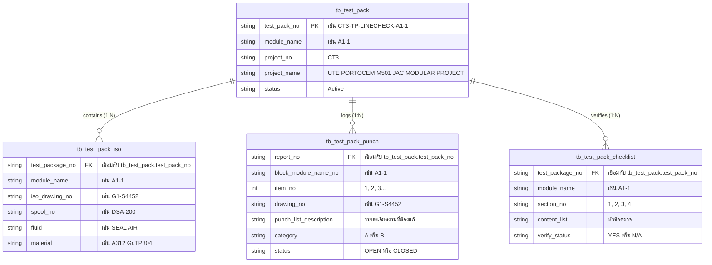

# 🤖 AI Agent Guide: QA/QC Test Package Dataset & API Integration

> **สำหรับ AI Agent ทุกตัว**: เอกสารนี้จัดทำขึ้นเพื่อให้ AI Agent (และ Developer) สามารถอ่าน เข้าใจโครงสร้าง และเรียกใช้งานชุดข้อมูล **Test Package (CIMTAS_CT3)** ได้ทันทีโดยไม่ต้องคาดเดา Schema

---

## 📌 สรุปภาพรวมและจุดประสงค์ของข้อมูล (Quick Context)

ชุดข้อมูลนี้คือ **เอกสาร QA/QC งานท่อ (Piping QA/QC Test Package)** สำหรับโครงการ **CIMTAS CT3 (UTE Portocem Modular Project)** จำนวน **25 Modules (Unit 1)**
มีจุดประสงค์เพื่อ:
1. ตรวจสอบการประกอบท่อ (Line Check / Pre-test Inspection)
2. ควบคุมและติดตามแบบ Isometric Drawing และ Spool ท่อ
3. บันทึกและติดตามรายการข้อบกพร่องที่ต้องแก้ไข (Process Punch-List)
4. ยืนยันความพร้อมของเอกสารก่อนทดสอบแรงดัน (Content Checklist)

---

## 🗺️ แผนผังโครงสร้างโฟลเดอร์ (Directory Map)

```
C:\Users\tn26015\Documents\GitHub\TestPackage\data\
│
├── AGENT_GUIDE.md                               # 👈 คู่มือนี้ (สำหรับ AI Agent)
├── README.md                                    # คู่มือภาพรวมโครงการ
│
├── 01_ct3_ute_portocem/                         # โครงการหลัก: CIMTAS_CT3 (25 Modules)
│   ├── json/                                    # ⚡ โฟลเดอร์ที่ AI Agent ควรเรียกใช้เป็นหลัก
│   │   ├── cimtas_ct3_master_database_seed.json # 🌟 รวมทั้ง 4 ตารางไว้ในไฟล์เดียว (One-stop seed)
│   │   ├── tb_test_pack.json                    # ตาราง Header (25 Modules)
│   │   ├── tb_test_pack_iso.json                # ตาราง Drawing & Spool ท่อ (195 แถว)
│   │   ├── tb_test_pack_punch.json              # ตาราง Punch List ข้อบกพร่อง (111 แถว)
│   │   └── tb_test_pack_checklist.json          # ตาราง Checklist การตรวจเอกสาร (100 แถว)
│   │
│   ├── excel_cleaned/                           # ตาราง Excel คลีนแล้ว (Multi-sheet)
│   │   └── CIMTAS_CT3_Test_Package_Cleaned.xlsx # 4 ชีต: tb_test_pack, iso, punch, checklist
│   │
│   └── markdown/                                # เอกสารสรุปเชิงเทคนิคและสถิติรายโมดูล
│       └── CIMTAS_CT3_TEST_PACKAGE_DATASET.md
│
└── 03_consolidated_master/                      # รวม Dataset พร้อมใช้งานสำหรับ Database กลาง
    ├── master_test_packs.json
    ├── master_drawings.json
    ├── master_punch_items.json
    └── Test_Package_Master_Cleaned.xlsx
```

---

## 🔗 ความสัมพันธ์ของตาราง (Relational Schema & Foreign Keys)



- **Foreign Key หลักในการ Join**:
  - `tb_test_pack.test_pack_no` = `tb_test_pack_iso.test_package_no`
  - `tb_test_pack.test_pack_no` = `tb_test_pack_punch.report_no`
  - `tb_test_pack.test_pack_no` = `tb_test_pack_checklist.test_package_no`
- **Join ระหว่าง Drawing กับ Punch**:
  - `tb_test_pack_iso.iso_drawing_no` = `tb_test_pack_punch.drawing_no`

---

## 📋 ตัวอย่างข้อมูล JSON (JSON Data Contracts)

### 1. Header (`tb_test_pack.json`)
```json
{
  "project_no": "CT3",
  "project_name": "UTE PORTOCEM M501 JAC MODULAR PROJECT",
  "client": "CIMTAS (NINGBO) STEEL PROCESSING CO., LTD",
  "contractor": "BJCHI",
  "module_name": "A1-1",
  "block_module_no": "A1-1",
  "unit_no": "1",
  "test_pack_no": "CT3-TP-LINECHECK-A1-1",
  "description": "Line Check & Test Package Dossier",
  "system_name": "Piping System",
  "piping_system": "PIPING",
  "rev_no": "0",
  "rev_description": "ISSUED FOR REVIEW",
  "rev_date": "2025-02-03",
  "prepared_by": "Parinya T.",
  "reviewed_by": "Prawit T.",
  "approved_by": "Phisit P.",
  "inspection_date": "2025-02-17",
  "location": "BJCHI",
  "test_stage": "Line Check",
  "status": "Active"
}
```

### 2. Drawing & Spool (`tb_test_pack_iso.json`)
```json
{
  "project_name": "UTE PORTOCEM M501 JAC MODULAR PROJECT",
  "test_package_no": "CT3-TP-LINECHECK-A1-1",
  "description": "Test pack isometric index",
  "module_name": "A1-1",
  "system_name": "SEAL AIR",
  "piping_system": "PIPING",
  "item_no": 1,
  "iso_drawing_no": "G1-S4452",
  "iso_sheet": "1",
  "iso_rev": "1",
  "pid_drawing_no": null,
  "pid_sht": null,
  "pid_rev": null,
  "module_no": "A1-1",
  "line_no": null,
  "spool_no": "DSA-200",
  "fluid": "SEAL AIR",
  "design_pressure_mpag_bar": null,
  "design_temperature_c": null,
  "test_pressure_bar": null,
  "test_type": "Line Check",
  "material": "A312 Gr.TP304",
  "insulation_spec": null,
  "insulation_thk_mm": null,
  "pipe_npd_in": null,
  "remark": null
}
```

### 3. Punch Item (`tb_test_pack_punch.json`)
```json
{
  "project_no": "CT3",
  "project_name": "UTE PORTOCEM M501 JAC MODULAR PROJECT",
  "report_no": "CT3-TP-LINECHECK-A1-1",
  "inspection_date": "2025-02-17",
  "test_stage": "Line Check",
  "block_module_name_no": "A1-1",
  "unit_no": "1",
  "location": "BJCHI",
  "process_discipline": "PIPING",
  "item_no": 1,
  "drawing_no": "G1-S4452",
  "punch_list_description": "Temporary support to be adjust linner plate to sit on full support no.04",
  "category": "A",
  "status_open": "Y",
  "status_closed": "Y",
  "status": "CLOSED",
  "punch_closing_prod_sup": null,
  "punch_closing_qci": null,
  "punch_closing_client_rep": null,
  "remarks": null
}
```

---

## 💻 ตัวอย่างโค้ดเรียกใช้งาน (Code Snippets for Agents)

### 🐍 Python: โหลดและค้นหาข้อมูลตามโมดูล
```python
import json
from pathlib import Path

DATA_DIR = Path(r"C:\Users\tn26015\Documents\GitHub\TestPackage\data\01_ct3_ute_portocem\json")

# 1. โหลดข้อมูลแบบ One-stop จากไฟล์ Master Seed
with open(DATA_DIR / "cimtas_ct3_master_database_seed.json", encoding="utf-8") as f:
    db = json.load(f)

test_packs = db["tb_test_pack"]
drawings = db["tb_test_pack_iso"]
punches = db["tb_test_pack_punch"]

# 2. ค้นหารายการ Punch List ที่ยังเปิดค้าง (OPEN) ของโมดูล A1-1
target_mod = "A1-1"
open_punches = [
    p for p in punches 
    if p["block_module_name_no"] == target_mod and p["status"] == "OPEN"
]
print(f"Module {target_mod} มี Punch ค้าง {len(open_punches)} รายการ")
for p in open_punches:
    print(f" - [{p['category']}] Dwg: {p['drawing_no']} -> {p['punch_list_description']}")
```

### 🌐 Node.js / JavaScript: โหลดและจัดกลุ่มข้อมูลตาม Fluid
```javascript
import { readFileSync } from 'node:fs';

const path = 'C:/Users/tn26015/Documents/GitHub/TestPackage/data/01_ct3_ute_portocem/json/tb_test_pack_iso.json';
const isos = JSON.parse(readFileSync(path, 'utf8'));

// จัดกลุ่มท่อตามชนิดของไหล (Fluid)
const byFluid = isos.reduce((acc, row) => {
  const f = row.fluid || 'UNKNOWN';
  acc[f] = (acc[f] || 0) + 1;
  return acc;
}, {});

console.log('สถิติท่อแยกตาม Fluid:', byFluid);
```

### 🐘 PHP: สำหรับใช้ใน Web App (`public/test_package.php`)
```php
<?php
$jsonPath = __DIR__ . '/../data/01_ct3_ute_portocem/json/tb_test_pack.json';
$testPacks = json_decode(file_get_contents($jsonPath), true);

// ดึงรายชื่อโมดูลทั้งหมด
$modules = array_column($testPacks, 'module_name');
// ['A1-1', 'A1-2', 'A1-3', ...]
?>
```

---

## ⚠️ กฎเหล็กและข้อแนะนำสำหรับ AI Agent (Agent Rules)

1. **ห้ามแก้ไขไฟล์ต้นทาง**:
   - ห้ามเขียนหรือดัดแปลงไฟล์ใน `\\192.168.100.12\qaqc` เด็ดขาด (เป็น Read-Only)
2. **ใช้ JSON เป็นหลัก**:
   - แนะนำให้อ่านจาก `data/01_ct3_ute_portocem/json/` เพราะ Clean แล้วและมี Type ถูกต้อง
3. **การกรองสถานะ Punch**:
   - `status == "CLOSED"` หรือ `status_closed == "Y"` = ปิดงานแล้ว
   - `status == "OPEN"` หรือ `status_closed != "Y"` = ยังต้องแก้ไข
4. **ความสำคัญของ Category**:
   - `Category A` = ข้อบกพร่องวิกฤต **ห้ามเริ่มทดสอบแรงดันเด็ดขาดจนกว่าจะปิด**
   - `Category B` = ข้อบกพร่องรอง สามารถดำเนินงานต่อได้ตามดุลยพินิจของ Project Manager
