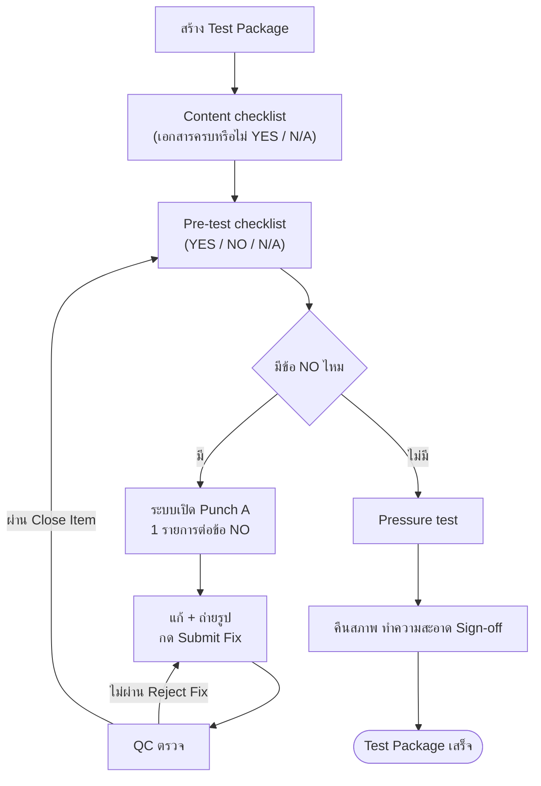

# คู่มือเด็กฝึกงาน: ทำความเข้าใจงาน Test Package และระบบ BJCHI QA/QC ERP

> เขียนสำหรับคนที่เรียนจบคอมพิวเตอร์ แต่ยังไม่เคยทำงานท่อ (piping) หรือ QC ในโรงงาน
> ที่มาของเนื้อหา: เอกสาร procedure ของโครงการ 8 ฉบับ (ไฟล์อยู่ที่ `data/filePDF/procedure_view_pdf*.pdf` รายชื่ออยู่ข้อ 4.0) กับโค้ดและเอกสารของระบบในโปรเจกต์นี้
> กติกาของคู่มือ: ตัวเลขทุกตัวมาจากเอกสารต้นฉบับ ตัวเลขที่อยู่ในรูปภาพของ PDF (ตารางค่า Torque, เกณฑ์ใน Appendix) จะเขียนว่า **"ดูในไฟล์จริง"** ไม่เดาให้ ส่วนที่คู่มือยังไม่แน่ใจจะเขียนว่า **"ควรถามทีม"**

---

## 0. อ่านอย่างไร

### 0.1 เส้นทางแนะนำ

| ใช้เวลา | อ่านส่วนไหน |
|---|---|
| 30 นาที | 0.2 (คำที่ต้องรู้) → ข้อ 1 → ข้อ 2 (ข้อ 2 อ้างถึงตารางสิทธิ์และหน้าเว็บในข้อ 3.1 และ 3.3 ให้เปิดดูคู่กัน) |
| 1.5 ชั่วโมง | เพิ่มข้อ 3 (ระบบเรา) และข้อ 4.0 ถึง 4.2 กับ 4.8 (เอกสารที่ตรงกับงานมากที่สุด) |
| 1 วัน | อ่านข้อ 4 ที่เหลือ และข้อ 4.9 (ตารางตัวเลขสำคัญ) แล้วทำแบบฝึกหัดข้อ 7 |

ข้อ 5 (อภิธานศัพท์) ไม่ต้องอ่านรวดเดียว ใช้เปิดค้นเมื่อเจอคำที่ไม่รู้ คำที่มีดาว ★ ควรรู้ก่อนเริ่มงาน

### 0.2 คำที่ต้องรู้ก่อนอ่านต่อ

| คำ | ความหมายสั้นที่สุด |
|---|---|
| **Piping** | ระบบท่อที่ส่งของไหล (แก๊ส น้ำ ไอน้ำ) ในโรงงานหรือโรงไฟฟ้า |
| **Spool** | ท่อท่อนที่ประกอบสำเร็จจากโรงงาน แล้วขนไปต่อกับท่อท่อนอื่น |
| **Module** | ก้อนงานสำเร็จรูปขนาดใหญ่ที่รวมท่อและโครงสร้างไว้ด้วยกัน |
| **Test Package** | แฟ้มหลักฐานของท่อหนึ่งชุด พิสูจน์ว่าทำถูก ตรวจครบ ทดสอบผ่าน |
| **QC** | Quality Control คนที่ตรวจงานว่าได้ตามข้อกำหนด |
| **ITP** | Inspection and Test Plan ตารางบอกว่าแต่ละขั้นต้องตรวจอะไร ใครต้องมาดู |
| **Pre-test** | รายการตรวจความพร้อมก่อนอัดแรงดัน |
| **Pressure test** | การอัดแรงดันเข้าท่อเพื่อดูว่ารั่วหรือไม่ |
| **Punch** | รายการงานค้าง/ข้อบกพร่องที่ต้องแก้ก่อนไปต่อ |
| **Hold / Witness** | จุดที่ต้องหยุดรอผู้ตรวจ / จุดที่ผู้ตรวจต้องมาดูด้วยตา |
| **Client / Owner** | Client = ลูกค้า (CIMTAS) ผู้ตรวจรับงานจากเรา / Owner = เจ้าของโครงการ (Mitsubishi Power) |
| **N2** | ก๊าซไนโตรเจน ใช้อัดทดสอบท่อ (ไม่ติดไฟ ไม่ทำให้ท่อเป็นสนิม) |
| **NDE** | Non-Destructive Examination การตรวจรอยเชื่อมโดยไม่ทำลายชิ้นงาน (เช่น เอ็กซเรย์ ผงแม่เหล็ก) |
| **P&ID / ISO** | P&ID = แผนผังเส้นทางท่อ / ISO (Isometric) = แบบท่อ 3 มิติรายเส้น ระบุข้อต่อและจุดเชื่อม |
| **Content checklist** | รายการตรวจว่าเอกสารของ pack มีครบหรือยัง |
| **Category A / B** | ระดับความรุนแรงของ Punch: A ห้ามทำงานต่อจนกว่าจะปิด, B ทำต่อได้ตามดุลยพินิจ PM |
| **Submit Fix / Close Item** | เจ้าหน้าที่กด Submit Fix เมื่อแก้เสร็จ, QC กด Close Item เมื่อตรวจผ่าน |

---

## 1. ภาพใหญ่: เรากำลังทำอะไรอยู่

### 1.1 บริบทของงาน

- **BJCHI** คือบริษัทของเรา เป็นผู้ผลิตและประกอบท่อและโครงสร้างเป็น **Module** (เรียกว่างาน modularization คือประกอบเป็นก้อนที่โรงงานก่อน แล้วค่อยส่งไปต่อที่หน้างานจริง)
- **CIMTAS** คือลูกค้า (Client) ผู้ตรวจรับงานจากเรา
- **Mitsubishi Power Americas (MPW-A)** คือเจ้าของโครงการ (Owner)
- โครงการที่ตัวอย่างในคู่มือนี้พูดถึงคือ **USA Project Unit 1 - Tallgrass** (รหัสงาน CT8) ระบบเรายังมีโครงการ CT3 และ CT5 อยู่แล้ว และมีข้อมูล CT9 ที่เตรียมนำเข้า (`tools/import_ct9.mjs`) ถ้าโครงการต่างกัน ฟอร์มและตัวเลขอาจต่างกัน ให้ยึดไฟล์ของโครงการนั้น

### 1.2 ท่อทำงานอย่างไร และทำไมต้องทดสอบ

ท่อในโรงไฟฟ้าส่งของไหลที่มีแรงดัน ถ้ารอยเชื่อมหรือหน้าแปลนมีรอยรั่ว ผลที่ตามมาตั้งแต่เสียของไปจนถึงอันตรายต่อคน (ก๊าซที่ถูกอัดไว้สะสมพลังงานมาก ถ้าท่อแตกจะปล่อยพลังงานนั้นออกมาทันที เหมือนยางรถที่ระเบิด ต่างจากน้ำซึ่งอัดตัวได้น้อย จึงมีกฎความปลอดภัยเข้มสำหรับการทดสอบด้วยก๊าซ) ก่อนส่งมอบจึงต้อง **อัดแรงดันเข้าท่อ** (เกินกว่าแรงดันใช้งานปกติเล็กน้อย) แล้วดูว่า **แรงดันตกหรือมีรอยรั่วไหม** นี่คือ Pressure test คนที่ทำคือทีมทดสอบของเรา โดยมีผู้ตรวจของลูกค้ามาดู (Witness) และลงนามรับรอง

ก่อนจะอัดแรงดันได้ ต้องมั่นใจว่าท่อ "พร้อม" (ประกอบครบ สะอาด น็อตขันแล้ว ไม่มีงานค้างที่อันตราย) ตรงนี้คือหน้าที่ของ **Pre-test** และ **Punch**

### 1.3 Test Package คืออะไร

ลองนึกถึง **Pull Request** ที่ต้องแนบหลักฐานครบก่อน merge Test Package คือ "แฟ้มหลักฐาน" ของท่อชุดหนึ่ง (เรียกว่า **system** หรือ **sub-system**) ที่ต้องพิสูจน์ว่า

1. ท่อทำถูกแบบ เชื่อมถูกวิธี และตรวจครบ (เอกสาร)
2. ท่อสะอาด ประกอบครบ พร้อมทดสอบ (Pre-test)
3. ท่อรับแรงดันได้และไม่รั่ว (Pressure test)
4. งานค้างทุกข้อถูกแก้และปิด (Punch)
5. ทุกฝ่ายลงชื่อรับรอง (Sign-off)

ของที่อยู่ในแฟ้ม (ตามข้อ 4.8): ใบปะหน้า, Content checklist, แผนผัง P&ID, แบบ Isometric, ประวัติการเชื่อม, รายงาน NDE, รายงานหน้าแปลน, บันทึกมิติ, Pre-test, ใบสอบเทียบเกจ, รายงานทดสอบแรงดัน, ความสะอาด, Punch List และเอกสารอื่น

### 1.4 ตัวอย่างหนึ่ง Test Package ตั้งแต่ต้นจนจบ (เล่าเป็นเรื่อง)

สมมติ pack ชื่อ `CT8-TP-MD-1.1-1` (Module MD-1.1, pack ที่ 1) ท่อชุดหนึ่งในโมดูล

1. **สร้าง pack:** QC ลงทะเบียนในหน้า Test Packages ใส่ระบบท่อ ตัวกลางทดสอบ (N2) แรงดันทดสอบ และเวลาคงแรงดัน
2. **เอกสาร:** ใส่แบบ Isometric ของท่อ pack นี้ (เฉลี่ยทุกโครงการรวมกัน ประมาณ 9 แถวต่อ pack: 508 แถว ÷ 58 pack จากตัวเลขใน `docs/project_status.md`) และติ๊ก Content checklist ว่าเอกสารครบหรือยัง
3. **Pre-test:** QC ไล่ตอบทุกข้อ ข้อหนึ่งตอบ **NO** เช่น ปลายท่อยังไม่ปิด → ระบบเปิด Punch Category A ให้เอง ข้อ Pre-test มีลักษณะเช่น เอกสารครบหรือไม่ ท่อสะอาดหรือไม่ น็อตหน้าแปลนขันแล้วหรือไม่ ปลายท่อและ Test blind ครบหรือไม่ เกจสอบเทียบแล้วหรือไม่ (ตัวอย่างลักษณะที่อิงจาก procedure ข้อ 4.4, 4.6, 4.8 ข้อจริงของโครงการดูในแท็บ Pre-test หรือตาราง `pretest_template`)
4. **Punch:** ทีมงานปิดปลายท่อ ถ่ายรูป กด Submit Fix → QC ตรวจ ผ่านแล้วกด Close Item แล้วแก้คำตอบ Pre-test ข้อนั้นเป็น YES
5. **Pressure test:** เมื่อไม่มี Punch A เปิดและ Pre-test ครบ แท็บ Pressure test ปลดล็อก ทีมอัด N2 ตามขั้นตอนในข้อ 4.8 บันทึกผล (ถ้าล้มเหลวบันทึกเป็นอีก attempt แล้วทดสอบซ้ำ)
6. **Sign-off:** QC, Engineering และ Client ลงชื่อ (ในระบบมีการวาดหรืออัปโหลดรูปลายเซ็น) แล้วพิมพ์รายงาน Punch เก็บเข้าแฟ้ม

---

## 2. ขั้นตอนของ Test Package (ละเอียด)

### 2.1 ตารางแต่ละขั้น: ใครทำ ทำที่ไหนในระบบ

| ขั้น | ผู้ทำ | หน้าเว็บ / แท็บ | เงื่อนไขผ่านไปขั้นถัดไป |
|---|---|---|---|
| สร้าง pack | admin / qc | Test Packages → เพิ่ม pack | ใส่ข้อมูล Info ครบ |
| Content checklist | qc | Test Package → แท็บ Contents | ตอบ YES หรือ N/A |
| ISO / Spool | qc | แท็บ ISO/Spool | มีรายการแบบของ pack |
| Pre-test | qc | แท็บ Pre-test | ตอบครบทุกข้อ และไม่มี NO |
| Punch | officer แก้, qc ตรวจ | แท็บ Punch หรือหน้า Punch List | Punch A ทุกรายการ Closed หรือ Cancelled |
| Pressure test | qc / admin | แท็บ Pressure test | ปลดล็อกก็ต่อเมื่อผ่านเงื่อนไขในข้อ 2.3 |
| Sign-off | qc / admin | แท็บ Sign-off (ปุ่ม Save sign-off, วาดหรืออัปโหลดลายเซ็น) | ดูข้อ 2.4 |

สิทธิ์ตาม role อยู่ข้อ 3.3 หน้าเว็บอยู่ในข้อ 3.1

### 2.2 Pre-test: YES, NO, N/A ต่างกันอย่างไร

| คำตอบ | ความหมาย | ผลในระบบ |
|---|---|---|
| YES | ตรวจแล้วเรียบร้อย | นับว่าผ่านข้อนั้น |
| N/A | Not Applicable ข้อนี้ไม่เกี่ยวกับ pack นี้ | นับว่าผ่านข้อนั้น |
| NO | ตรวจแล้วไม่เรียบร้อย | สร้าง Punch Category A 1 รายการอัตโนมัติ และ **ห้ามทดสอบแรงดัน** |
| ยังไม่ตอบ | ยังไม่ได้ตรวจ | Pressure test ยังถูกล็อก (ต้องตอบให้ครบ) |

เปลี่ยนคำตอบจาก NO เป็นอย่างอื่น: ถ้า Punch ที่ระบบสร้างยัง Open จะถูกเปลี่ยนเป็น **Cancelled** (ไม่ลบ) ถ้า Closed แล้วคงไว้เป็นประวัติ

### 2.3 เงื่อนไขปลดล็อก Pressure test (จากโค้ด `public/assets/js/tp_pressure.js`)

ถูกล็อก ถ้าข้อใดข้อหนึ่งเป็นจริง
1. มี Punch **Category A** ที่ยัง Open อยู่
2. แม่แบบ Pre-test ของ pack ว่างเปล่า (แก้ที่ตาราง `pretest_template` ซึ่งสร้างใน `sql/07_pretest_checklist.sql` → **ควรถามทีม** ก่อนแก้)
3. ดึงสถานะ Pre-test ไม่ได้ (ระบบถือว่า "ไม่รู้ = ล็อกไว้ก่อน")
4. Pre-test มีข้อที่ตอบ NO
5. Pre-test ตอบยังไม่ครบ

ถ้ามี Punch **Category B** ค้าง ยังทดสอบได้ ตามดุลยพินิจของ PM (Project Manager ผู้จัดการโครงการ) ระบบแสดงข้อความเตือน ส่วนตาราง `pressure_tests` รับชนิดการทดสอบได้ทั้ง `hydro` (ใช้น้ำ) และ `pneumatic` (ใช้ก๊าซ)

### 2.4 Sign-off

แท็บ Sign-off เก็บชื่อ วันที่ และรูปลายเซ็นของ Test Package และของใบ Punch List (โค้ดอยู่ที่ `tp_signature.js` สิทธิ์: QC/admin เพิ่มลบรูปได้ คนอื่นดูอย่างเดียว) ผู้ลงนามตามฟอร์ม CT8 คือ Engineering, QC และ Client ในโค้ดที่ตรวจ (`tp_signature.js`, `tp_pressure.js`) ไม่พบการล็อก Sign-off ตามสถานะ Pressure test หรือ Punch → **ควรถามทีม** ว่าต้องมีเงื่อนไขนี้หรือไม่

### 2.5 Punch: สองระบบที่ชื่อคล้ายกันแต่ไม่เหมือนกัน

| | Punch ในระบบเรา (ฟอร์ม CT8) | Punch ใน ITP งาน Instrument/Fire Fighting (ไฟล์ข้อ 4.1) |
|---|---|---|
| Category | **A** และ **B** | **A1, A, B, C** |
| A | ห้ามทำงานต่อจนกว่าจะปิด และบล็อก Pressure test | A = ต้องปิดก่อน Turnover (ส่งมอบ) |
| A1 | ไม่มี | หยุดทดสอบ หรือเสี่ยง HSE (ความปลอดภัย) |
| B | ทำต่อได้ตามดุลยพินิจ PM | ปิดหลัง Turnover ก่อน Start-up (เริ่มเดินเครื่อง) |
| C | ไม่มี | ปิดก่อน Acceptance (ลูกค้ารับมอบ) |
| สถานะ | Open / Closed / Cancelled | ช่อง Sign Clear ของ BJCHI, CIMTAS, MPW-A |

สรุป: อย่าเอา "A" ของสองระบบมาเทียบกันตรงๆ ในระบบเราให้ยึดนิยามฟอร์ม CT8 (A = ห้ามทำต่อ) เมื่ออ่าน ITP ให้ดูนิยามในตัวเอกสารนั้นเสมอ

### 2.6 วงจร Punch ในระบบ

เจ้าหน้าที่แก้และถ่ายรูป → **Submit Fix** (ยังเป็น Open) → QC ตรวจ → ผ่านคือ **Close Item** / ไม่ผ่านคือ **Reject Fix** (ยัง Open ต้องแก้ใหม่) / QC สั่ง **Cancel** ได้ / **Reopen** ได้ สถานะมี 3 ตัวเท่านั้น: Open, Closed, Cancelled

---

## 3. ระบบเรามีอะไรบ้าง

### 3.1 หน้าเว็บ (`public/`)

| ไฟล์ | หน้าที่ |
|---|---|
| `login.php` | เข้าสู่ระบบ |
| `index.php` | Dashboard |
| `test_packages.php` | ทะเบียน Test Package (Register) กรองตามสถานะ Export CSV เพิ่ม pack |
| `test_package.php` | รายละเอียด pack: Info, Contents, ISO/Spool, Pre-test, Punch, Pressure test, Sign-off |
| `punch_list.php` | Punch List แบบย่อ |
| `qc_list.php` | ตารางขั้นสูง (Advanced Grid) สำหรับ admin |
| `punch_report.php` | รายงาน Punch สำหรับพิมพ์ |
| `field.php`, `field_pack.php` | Field mode ใช้บนแท็บเล็ตหน้างาน |
| `data_guide.php` | คู่มือข้อมูล |
| `admin_master.php`, `admin_users.php` | จัดการข้อมูลหลัก (Category, Discipline) และผู้ใช้ |

### 3.2 ตัวอย่างการใช้งานจริง (walkthrough)

1. เปิด `login.php` ล็อกอิน
2. เมนูไป **Test Packages** (`test_packages.php`) กรองหา pack หรือกดเพิ่ม pack ใหม่
3. กดชื่อ pack เข้าหน้ารายละเอียด (`test_package.php?id=...`) เปิดแท็บ **Pre-test** ตอบทีละข้อ ตอบ NO หนึ่งข้อ
4. ไปแท็บ **Punch** จะเห็นรายการ Punch A ที่ระบบสร้างให้ ลองกด Submit Fix แล้ว Close Item (ใช้บัญชี qc)
5. กลับแท็บ Pre-test แก้คำตอบเป็น YES
6. เปิดแท็บ **Pressure test** ดูว่าข้อความล็อกหายไปหรือไม่
7. เปิดหน้า Punch Report พิมพ์รายงาน

#### สิ่งที่จะเห็นบนหน้าจอ (ข้อความจริงจากโค้ด)

| ตอนไหน | ข้อความบนจอ |
|---|---|
| Pressure test ถูกล็อก | "Pressure test is locked." พร้อมรายการเหตุผลและลิงก์ไปแท็บที่ต้องแก้ เช่น "N Category A punch item(s) still open." |
| Pre-test มี NO | "The pre-test checklist has N item(s) answered NO." |
| Pre-test ไม่ครบ | "The pre-test checklist is incomplete (x of y answered)." |
| พร้อมทดสอบ | "Ready for pressure test." |
| ทดสอบผ่าน | ป้าย "Test passed" และ "Pressure test passed on <วันที่>" |
| ทดสอบไม่ผ่าน | ป้าย "Test failed" (ต้อง retest) |

ต้องมีบัญชีและข้อมูลทดสอบ ขอจากทีมตามข้อ 3.5

### 3.3 สิทธิ์ผู้ใช้ (role)

| role | ทำอะไรได้ |
|---|---|
| `admin` | ทุกอย่าง |
| `qc` | แก้ ปิด ยกเลิก เพิ่ม Punch |
| `officer` | Submit Fix |
| `viewer` | อ่านอย่างเดียว (เหมาะกับลูกค้า) |

กฎเหล็ก: ซ่อนปุ่มฝั่งหน้าเว็บอย่างเดียวไม่พอ ต้องบังคับสิทธิ์ซ้ำที่ฐานข้อมูลด้วย **RLS (Row Level Security)** คือกฎใน PostgreSQL ที่บอกว่า role ไหนอ่านหรือเขียนแถวไหนได้ เพราะผู้ใช้เรียก API ตรงโดยไม่ผ่านหน้าเว็บได้

### 3.4 ตารางฐานข้อมูล

ชื่อตารางทั้งหมดยืนยันจาก `create table` ใน `sql/` ส่วนคอลัมน์ยืนยันแล้วเฉพาะบางตาราง (ระบุไว้ด้านล่าง) ที่เหลือเปิดดูตามไฟล์ที่ระบุ

| ตาราง | ความหมาย | ไฟล์ SQL |
|---|---|---|
| `projects` | โครงการ (CT8, CT3, CT5) | `01_schema.sql` |
| `test_packs` | หนึ่งแถวต่อหนึ่ง Test Package (มีแรงดันทดสอบ เวลาคงแรงดัน และคอลัมน์ลายเซ็น) | `06_test_package_register.sql`, `14_signatures.sql` |
| `iso_lines` | แบบ Isometric/Spool ของแต่ละ pack | `08_datasets_iso_contents.sql` |
| `drawings` | รายการ **แบบ** ของ pack (เลขแบบ ชีต ชนิดงานเชื่อม/ไม่เชื่อม ไฟล์รายงาน) ชื่อในคอมเมนต์เขียนว่า "punchlist" ซึ่งเป็นชื่อเก่า **ไม่ใช่ตาราง Punch** | `01_schema.sql` |
| `pack_documents` | รายการเอกสารของ pack (Content checklist) | `08_datasets_iso_contents.sql` |
| `pretest_template` / `pretest_items` | แม่แบบข้อ Pre-test / คำตอบของแต่ละ pack | `07_pretest_checklist.sql` |
| `punch_items` | รายการงานค้าง | `01_schema.sql` |
| `punch_item_history` | ประวัติแก้ไขรายการ Punch | `16_punch_item_history.sql` |
| `punch_rounds`, `punch_reports` | รอบการตรวจและใบรายงาน Punch | ดูใน `sql/` |
| `pressure_tests` | ผลทดสอบแรงดันแต่ละครั้ง (attempt, วันที่, hydro/pneumatic, แรงดันที่ต้องการ เป็น bar g, ค่าที่อ่านได้, เวลาคงแรงดัน) | `12_pressure_test.sql` |
| `categories`, `disciplines` | หมวด Punch (A/B) และแผนก | `01_schema.sql` |
| `profiles` | ผู้ใช้และ role | `01_schema.sql` |

แถว `punch_rounds` และ `punch_reports` ผู้เขียนคู่มือยังไม่ได้ยืนยันคอลัมน์ ให้เปิดไฟล์ SQL ดูเอง ส่วนแผนภาพความสัมพันธ์ (ER) ของชุดข้อมูล CT3 อยู่ใน `data/AGENT_GUIDE.md` ซึ่งใช้อ้างอิงเพิ่มเติมได้ (โครงสร้างข้อมูลชุด CT3 ไม่ใช่โครงสร้างตารางของ Supabase ทั้งหมด)

ความสัมพันธ์สรุป: `projects` 1 โครงการมีหลาย `test_packs`, และ `test_packs` 1 pack มีหลายแถวในตารางลูกส่วนใหญ่ (เช่น `drawings`, `pressure_tests` ผูกด้วยคอลัมน์ `test_pack_id` ยืนยันแล้ว ส่วนตารางอื่นดูในไฟล์ SQL)

### 3.5 รันระบบในเครื่อง (สรุปจาก `README.md`)

> สำหรับเด็กฝึกงานใหม่: ส่วนนี้เหมาะกับคนที่ตั้งค่าเครื่องเองเป็น **ควรขอให้ทีมตั้งค่าโปรเจกต์ Supabase ทดสอบและส่งไฟล์ `.env` ให้** (วางไว้ที่โฟลเดอร์รากของโปรเจกต์ ข้างๆ `README.md`) (ผู้ติดต่อ: ______ ให้ทีมกรอก) แล้วทำเฉพาะข้อ 1 และ 5 ถ้าสำเร็จจะเห็นหน้าล็อกอินของระบบที่ http://localhost:8000/login.php และล็อกอินด้วยบัญชีทดสอบที่ทีมให้ (อย่าใช้ฐานข้อมูลจริงของโครงการ) ส่วนข้อ 2 ถึง 4 เป็นการตั้งค่าฐานข้อมูล โดย `SUPABASE_URL` และ publishable key หาได้ที่ Supabase > Project Settings > API (publishable key ส่งให้เบราว์เซอร์ได้ แต่ **secret key ห้ามเผยแพร่**)

1. ต้องมี PHP 8.3 ขึ้นไป และ Node.js 18 ขึ้นไป
2. สร้างโปรเจกต์ Supabase แล้วรัน `sql/01` ถึง `16` ตามลำดับใน SQL Editor (ข้อ 09 ไม่บังคับ)
3. คัดลอก `.env.example` เป็น `.env` ใส่ `SUPABASE_URL` และคีย์ (ถามทีมเรื่องโปรเจกต์ Supabase สำหรับทดสอบ อย่าใช้ฐานข้อมูลจริงของโครงการ)
4. สร้างผู้ใช้ใน Supabase Authentication แล้วตั้ง role ในหน้า Admin → Users
5. รัน `php -S localhost:8000 -t public` แล้วเปิด http://localhost:8000/login.php (ต้องชี้ `-t public` เสมอ)

### 3.6 ฟังก์ชันที่มักเจอในโค้ด

| ชื่อ | ทำอะไร | อยู่ไฟล์ |
|---|---|---|
| `esc()` | แปลงอักขระพิเศษก่อนใส่ `innerHTML` กัน XSS | `public/assets/js/app.js` |
| `friendlyErr()` | แปลงข้อความ error ดิบเป็นข้อความที่คนอ่านเข้าใจ | `public/assets/js/app.js` |
| `today()` | วันที่ตามเวลาเครื่อง (ไม่ใช่ UTC) | `public/assets/js/punch_common.js` |
| `pressureGate()` | ตัดสินว่า Pressure test ล็อกหรือไม่ | `public/assets/js/tp_pressure.js` |
| `source_key` | คีย์ที่ผูก Punch ที่ระบบสร้างจากข้อ Pre-test กับข้อนั้น ทำให้กด NO ซ้ำแล้วไม่เกิด Punch ซ้ำ | `sql/07_pretest_checklist.sql` |

### 3.7 สถานะความคืบหน้า

ดู `docs/project_status.md` ล่าสุด ระบบมี gate Pressure test และแท็บ Pressure test ในโค้ดแล้ว แต่เอกสารสถานะยังระบุว่าหน้าใหม่ **ยังไม่ผ่านการทดสอบกับข้อมูลจริงหลังล็อกอิน** อย่าถือว่าทุกอย่างเสร็จ ขั้นตอนในแบบฝึกหัด 7.1 อาจพังหรือต่างจากที่เขียน ให้แจ้งทีมเมื่อพบ

### 3.8 ภาพรวมสถาปัตยกรรม (สำหรับคนจบคอม)

หน้าเว็บเป็น PHP 8.3 (`public/*.php` ประกอบหน้าและส่วนร่วมจาก `app/includes/`) แต่ตรรกะส่วนใหญ่อยู่ใน JavaScript ฝั่งเบราว์เซอร์ (`public/assets/js/`) ซึ่งเรียก Supabase (PostgreSQL + Auth + Storage) โดยตรงด้วย publishable key ความปลอดภัยจริงอยู่ที่ RLS ในฐานข้อมูล ไม่ใช่ที่ PHP ตัวนำเข้าข้อมูล (`tools/*.mjs`, Node.js) ใช้ secret key รันในเครื่องเท่านั้น

หมายเหตุผู้ลงนาม: ข้อ 2.4 (ผู้ลงนามตามฟอร์ม Test Package: Engineering, QC, Client) กับ ITP ข้อ 4.1 และ 4.2 (BJC, CIMTAS, Mitsubishi Power) เป็นคนละเอกสาร คือฟอร์มที่เซ็นต่างกัน เทียบตรงๆ ไม่ได้

---

## 4. สรุปเอกสาร procedure ทั้ง 8 ฉบับ

### 4.0 ควรอ่านอะไรก่อน

| ลำดับ | ไฟล์ | เหตุผล |
|---|---|---|
| **อ่านก่อน (ตรงกับงานเรา)** | 4.8 Pneumatic Testing (N2) | เกณฑ์ Pressure test |
| | 4.2 ITP Piping Assembly | ลำดับตรวจตั้งแต่ประกอบถึงลงนาม |
| **อ่านรอง** | 4.4 Bolt Tightening, 4.5 Visual Inspection, 4.6 Module Assembly/Cleanliness | เป็นเกณฑ์ที่ใช้ใน Pre-test |
| | 4.1 ITP Instrument/Fire Fighting, 4.7 Air/Impulse Line | งานเครื่องมือวัด |
| **อ่านคร่าว** | 4.3 Project Quality Plan | ภาพรวมระบบคุณภาพ ไม่ใช่ขั้นตอนทดสอบ |

ตำแหน่งไฟล์ (ใน `data/filePDF/`): `procedure_view_pdf.pdf` = 4.1, `(1)` = 4.2, `(2)` = 4.3, `(3)` = 4.4, `(4)` = 4.5, `(5)` = 4.6, `(6)` = 4.7, `(7)` = 4.8

คำศัพท์ที่ใช้ซ้ำในทุกข้อ: **H** = Hold (หยุดรอ), **W** = Witness (ไปดูด้วย), **M** = Monitor (เฝ้าดู), **R** = Review (ตรวจเอกสาร), **V** = Verify, **A** = Approve อธิบายในข้อ 5.6

### 4.1 ITP งาน Instrumentation และ Fire Fighting
- **เอกสาร:** CT8-ITP-EI-001 Rev.2 ยาว 2 หน้า พร้อมแบบฟอร์มแนบ
- **ลำดับ:**
  1. เอกสาร Spec/AFC (แบบอนุมัติให้ก่อสร้าง)
  2. งานเชื่อม
  3. สอบเทียบเครื่องมือ
  4. ตรวจรับวัสดุ
  5. Method Statement ต้องอนุมัติก่อนลงมือ
  6. ระหว่างติดตั้ง (หัวข้อ 7.x)
  7. หลังติดตั้ง (หัวข้อ 8.x)
- **หลังติดตั้ง:** 8.5 Pressure Test (ฟอร์ม FIC-INS-005), 8.8 ทดสอบสายไฟ/ควบคุม, 8.9 Final Punch list (ฟอร์ม F-QA-026), 8.10 As-built
- **ใครมีหน้าที่อะไร:** BJCHI เป็น Hold แทบทุกขั้น ส่วน CIMTAS เฝ้าดู (M) ตอนติดตั้ง และไปเป็นพยาน/ตรวจเอกสาร (W/R) หลังติดตั้ง ส่วน Mitsubishi Power ตรวจเอกสาร (R) เป็นหลัก
- **ตัวเลข:** ไม่มีตัวเลขในตัว ITP เอง แรงดันทดสอบและแรงดัน Megger เป็นช่องว่างที่ต้องกรอกในฟอร์มตอนทำงาน ให้ดู Method Statement (ข้อ 4.7)
- **เชื่อมกับระบบ:** หมวด Punch ของฟอร์ม F-QA-026 ละเอียดกว่าระบบเรา ดูตารางเทียบในข้อ 2.5
- **คุณต้องรู้แค่นี้:** เอกสารนี้ใช้กับงานเครื่องมือวัดและดับเพลิง ถ้างานคุณคือท่อ ให้อ่านผ่านๆ แล้วไปข้อ 4.2 ก่อน

### 4.2 ITP งานประกอบท่อ (Piping Assembly)
- **เอกสาร:** CT8-ITP-PI-001 Rev.0 มี **20 หัวข้อ** ลำดับหลักคือ
  1. เอกสารและ WPS/PQR → รับวัสดุ → เตรียมและเก็บ spool
  2. Fit-up และเชื่อม → NDT → ซ่อม
  3. IRN → ตรวจก่อนทดสอบ → Pneumatic test
  4. ติดตั้งกลับ → Trial assembly → ทำความสะอาดและทาสี
  5. ฉนวน → Tagging/Packing → ตรวจสุดท้าย → เอกสาร
- **จุดที่ตรงกับ Test Package ของเรา:**

| ขั้นในระบบเรา | หัวข้อใน ITP |
|---|---|
| Pre-test | 12 (ตรวจรวม/สำรวจมิติ) และ 13A (Line check) |
| ปล่อยให้ทดสอบ | 13B |
| Pressure test | 13C (Pneumatic ด้วย N2) และ 13D ความสะอาดภายใน |
| Punch | 14C "Line Check & Test Package Punch List" และงานค้างผ่าน IRN (หัวข้อ 11) |
| Sign-off | 19B Inspection Release Certificate (ทั้ง 3 ฝ่ายเป็น Hold) และ COI/เอกสารรวมเล่ม (หัวข้อ 20) |

- **Witness ของ CIMTAS:** PT/MT, RT, Pneumatic test, Trial assembly, สำรวจมิติ
- **ตัวเลข:** ไม่มีค่าแรงดันหรือเวลาในเอกสารนี้ ไปดู 4.8 ตัวเลขเดียวคือต้องแจ้งลูกค้าภายใน **48 ชั่วโมง** ถ้าพบความผิดปกติของวัสดุ
- **เอกสารอ้างอิง:** อยู่ในภาคผนวก ก ท้ายคู่มือ (ไม่ต้องจำรหัส)
- **คุณต้องรู้แค่นี้:** ITP นี้คือ "สารบัญของทั้งงานท่อ" จำได้ 3 จุดก็พอ: หัวข้อ 12-13 คือช่วงก่อนทดสอบ (ตรงกับ Pre-test), 13C คือการทดสอบแรงดัน, 19B คือใบรับรองลงนาม 3 ฝ่าย (ตรงกับ Sign-off)

### 4.3 Project Quality Control (Project Quality Plan)
- **เอกสาร:** CT8-PRO-CM-001 Rev.0 (25 หน้า) เป็นคู่มือระบบคุณภาพของโครงการตามมาตรฐาน **ISO 9001:2015** ไม่ใช่ขั้นตอนทดสอบ
- **ระบบคุณภาพแบ่ง 3 ระดับ:** (1) แผนและ procedure เขียนไว้ (2) work instruction และ checklist สำหรับคนทำงาน (3) การตรวจจริงหน้างาน เช่น witness, audit
- **ที่ไซต์:** Receiving inspection → In-process → Final inspection → NCR และ Corrective action
- **หลักที่ควรจำ:** ในระหว่างงานมี Hold point คือ "หยุดงานจนตรวจเสร็จและรายงานได้รับการตรวจสอบ" และห้ามส่งหรือใช้งานจนกิจกรรมใน ITP เสร็จและเอกสารได้รับอนุมัติ
- **ตัวเลข:** ไม่มีค่าเชิงเทคนิค เกณฑ์ผ่านคือ "ตรงตามข้อกำหนดใน ITP/spec/code"
- **เชื่อมกับระบบ:** แนวคิด Hold point และ NCR เป็นที่มาของกฎ "Punch A เปิดอยู่ ห้ามทดสอบ"

### 4.4 Bolt Tightening Inspection (การขันน็อต)
- **เอกสาร:** CT8-PRO-CM-008 Rev.0 อ้างอิง ASME PCC-1 และ ASME B31.1
- **งานท่อ:** ขันตามค่า **Torque** เป้าหมายในตาราง (แยกตามชนิด gasket และ Class ของหน้าแปลน) ตัวเลขอยู่ในตารางที่เป็นรูปภาพ → **ดูในไฟล์จริง**
- **ถ้าไม่มีค่า Torque:** ใช้วิธีวัดระยะห่างหน้าแปลน 4 จุด ขันตามลำดับจน gasket ถูกอัดแน่นลง (ระยะห่างหน้าแปลนลดลง) **0.8 ถึง 1.2 mm** ทุกจุด แล้วล็อกกันน็อตหมุน
- **งานโครงสร้าง:** ขันแบบ **Snug** คือขันพอแนบแน่น ไม่ใช่ขันเต็มแรง
- **เครื่องมือ:** ต้องมีใบสอบเทียบ และสอบเทียบซ้ำทุก **6 เดือน**
- **เชื่อมกับระบบ:** แบบฟอร์ม Attachment 1 (Bolt Tightening Inspection Report - Piping) ควรแนบใน Test Package เป็นหลักฐาน

### 4.5 Visual Inspection Procedure (ตรวจรอยเชื่อมด้วยตา)
- **เอกสาร:** CT8-PRO-CM-012 Rev.0
- **เงื่อนไขการตรวจ:** ตรวจจากระยะไม่เกิน **24 นิ้ว** (ราว 61 ซม.) มุมไม่น้อยกว่า **30 องศา** แสงอย่างน้อย **100 foot-candles** (ประมาณ 1,000 lux) ผู้ตรวจต้องมีใบรับรองเช่น CSWIP หรือ AWS
- **ลำดับ:** ตรวจวัสดุ → เตรียมขอบ → Fit-up (100%) → Tack weld → ระหว่างเชื่อม (ดูกระแสไฟ แรงดันไฟ ความเร็วเชื่อม) → หลังเชื่อม ตรวจ 100% → ตรวจมิติ → ตรวจสุดท้าย
- **เกณฑ์ผ่าน:** ตาม ASME B31.1 ข้อ 136.4.2, ISO 5817 และ AWS D1.1 ตัวเลขใน Appendix 1-3 เป็นรูปภาพ → **ดูในไฟล์จริง**
- **เชื่อมกับ Punch:** ข้อบกพร่องที่พบให้บันทึกลงแบบ AFC เพื่อติดตามต่อ นี่คือต้นเหตุของ Punch หลายรายการ

### 4.6 Module Assembly and Preservation (ประกอบ รักษาสภาพ และความสะอาด)
- **เอกสาร:** CT8-PRO-CM-014 Rev.0 (ชื่อจริงไม่มีคำว่า Cleanliness แต่เป็นหัวข้อ 6)
- **ประกอบ:** ทำในพื้นที่ปิด แยกจากงานตัดและโครงสร้าง มีอบรมเรื่อง **FOD** ใส่ **Dam plug** ตอนเชื่อม ปิดปลายท่อทุกครั้งเมื่อเลิกงาน
- **ความสะอาด:** ตรวจภายในท่อ 100% ของทุก module ด้วย **Borescope** เกณฑ์ผ่านคือไม่มีเศษหรือสิ่งแปลกปลอม QC ลงชื่อใน Cleanliness Verification Record (Attachment 2)
- **รักษาสภาพ:**
  - ใส่ถุงดูดความชื้น (Desiccant bag) และสารกันสนิมระเหย (VpCI)
  - ปิดหน้าแปลนด้วย gasket ยางเต็มหน้าหนา 1/8 นิ้ว และแผ่นเหล็กชุบสังกะสีหนา 1/8 นิ้ว
  - เป้าหมายคือไม่ให้ท่อเสื่อมหรือเป็นสนิมในช่วงรอ (เอกสารกำหนดอย่างน้อย **6 เดือน** เว้นแต่ระบุอื่น)
- **เชื่อมกับ Test Package:** ต้องเป่าลมล้างท่อก่อน Pneumatic/Leak test และต้องมี Cleanliness Record เป็นเอกสารประกอบ

### 4.7 Method Statement: Air Supply และ Impulse Line
- **เอกสาร:** CT8-PRO-CM-018 Rev.1 (ชื่อจริงมีคำว่า Installation) **ใช้กับงานเครื่องมือวัด ไม่ใช่ท่อกระบวนการหลัก**
- **Impulse line คืออะไร:** ท่อหรือทิวบ์เล็กๆ ที่ส่งแรงดันจากกระบวนการไปที่เครื่องวัด ส่วน **Air supply** คือท่อลมสำหรับเครื่องมือ
- **ติดตั้ง:** ท่อเชื่อมแบบ socket weld ด้วยวิธี TIG, ทิวบ์ใช้ข้อต่อ compression ขนาด 1/2 นิ้ว OD หนา 0.065 นิ้ว, ซัพพอร์ตทุก 1 ถึง 2 เมตร, ต้องมี drain จุดต่ำสุด
- **ทดสอบรั่ว:** เป่าสะอาด → อัดแรงดันด้วย N2 หรืออากาศ → ทาน้ำสบู่ทุกข้อต่อ → ถ้ารั่วซ่อมแล้วทดสอบซ้ำ → ลดแรงดัน → ติดสติกเกอร์สถานะ (Airline = สีเหลือง)
- **เกณฑ์:** ผ่านเมื่อแรงดันที่เกจไม่ตกเกินหนึ่งขีดสเกลที่อ่านได้ตลอดช่วงคงแรงดัน อย่างน้อย **10 นาที** ทดสอบที่ **1.25 เท่า** ของแรงดันออกแบบ/สูงสุด ตัวคูณของ Impulse line ในข้อความที่ดึงมาไม่ครบ → **ดูในไฟล์จริง**
- **Witness:** ทุกการทดสอบต้องมีตัวแทน Client เป็นพยาน
- **ตัวคูณ 1.25 กับ 1.2 ในข้อ 4.8 ต่างกัน:** เป็นคนละ procedure กับงานคนละชนิด (เครื่องมือวัด กับ ท่อ) ในระบบเราให้ใช้ค่าแรงดันทดสอบที่ระบุใน Info ของ pack นั้น และถ้าไม่แน่ใจ **ควรถามทีม**

### 4.8 Pneumatic Testing Procedure (N2) — ตรงกับแท็บ Pressure test มากที่สุด
- **เอกสาร:** CT8-PRO-PI-007 Rev.0 ครอบคลุมการทดสอบ ล้าง (Flushing) และทำให้แห้ง (Drying) ท่อ ตาม ASME B31.1
- **ทำไมใช้ N2 แทนน้ำ:** เอกสารกำหนดให้ใช้ก๊าซ (ไม่ได้อธิบายเหตุผล) เหตุผลทั่วไปคือท่อบางชุดห้ามมีน้ำค้างหรือรับน้ำหนักน้ำไม่ได้ **ควรถามทีม** ถ้าต้องการเหตุผลของโครงการนี้โดยเฉพาะ
- **ก่อนทดสอบ (Preparation):**
  - ขอ **Permit to Work**
  - กั้นพื้นที่และติดป้ายเตือน ทีมทดสอบเท่านั้นเข้าใกล้ท่อที่มีแรงดันได้ในระยะ **5 เมตร**
  - แยกหรือถอดอุปกรณ์ที่ไม่ร่วมทดสอบ และบันทึกใน Piping Isolation Record
  - ติด Test blind (หูจับยื่น 100 ถึง 200 mm ทาสีแดง) และถอดเครื่องมือที่อยู่ในแนวท่อ
  - รอยต่อทุกจุดต้องเปิดไม่หุ้มฉนวน เพื่อให้เห็นรอยรั่ว
- **ขั้นทดสอบ (เรียงตามเวลา):**
  1. เพิ่มแรงดันเป็นขั้น พักที่ประมาณ 50% และ 80% ของแรงดันทดสอบเพื่อตรวจรั่วเบื้องต้น (ตรวจเบื้องต้นนี้ทำโดยไม่เข้าใกล้ท่อที่มีแรงดัน รายละเอียดวิธีตรวจ **ดูในไฟล์จริง**)
  2. ถึงแรงดันทดสอบ = **1.2 เท่าของ Maximum working pressure** คงไว้อย่างน้อย **10 นาที**
  3. ลดแรงดันลงเหลือค่าที่ **น้อยกว่า** ระหว่าง Design pressure กับ **100 psig (700 kPa g)**
  4. ตรวจรั่วละเอียดด้วยน้ำสบู่ทุกรอยต่อที่แรงดันที่ลดลงแล้ว **ห้ามมีรอยรั่วเลย**
- **ข้อห้ามด้านความปลอดภัยที่ต้นฉบับกำกวม:** ต้นฉบับห้ามตรวจรั่วระหว่างเพิ่มแรงดัน และภายใน 15 นาทีหลังจากนั้น แต่ไม่ชัดว่าข้อนี้หมายถึงการเข้าใกล้ท่อตอนแรงดันสูง หรือการตรวจตามขั้น 1 → **ดูในไฟล์จริง หรือถามทีมก่อนลงมือทดสอบ** อย่าตีความเอง
- **ตัวอย่างตัวเลข (สมมติ ไม่ใช่ข้อมูลโครงการ):** Maximum working pressure = 10 bar g แรงดันทดสอบ = 1.2 × 10 = 12 bar g คงไว้ 10 นาที ถ้า Design pressure = 12 bar g (ราว 174 psig) ส่วน 100 psig ≈ 6.9 bar g ค่าที่น้อยกว่าคือ 100 psig ให้ลดแรงดันลงเหลือประมาณ 6.9 bar g แล้วค่อยตรวจรั่วด้วยน้ำสบู่
- **เกจ:** ช่วงเต็มสเกล 1.5 ถึง 4 เท่าของแรงดันทดสอบ, เส้นผ่านศูนย์กลาง 75 mm ขึ้นไป, สอบเทียบไม่เกิน 12 เดือน, ใช้อย่างน้อย 2 ตัว (จุดสูงสุดและต่ำสุด)
- **Manifold:** ทดสอบแยกที่ไม่น้อยกว่า 120% ของแรงดันทดสอบระบบ
- **รายงาน:** ฟอร์ม **F-QA-173 Rev.1** พร้อมรูปถ่าย Client (และ Owner ถ้าจำเป็น) ต้องเป็นพยานและลงนาม
- **Punch ก่อนทดสอบ:** Punch ที่เป็นอุปสรรคต้องไม่เหลือ และจุด "A" ต้องปิดก่อน ตรงกับกฎของระบบเรา
- **ข้อจำกัด:** Appendix 1-2 และสูตรความหนา Test blind เป็นรูปภาพ → **ดูในไฟล์จริง**
- **เชื่อมกับระบบ:** ฟิลด์ใน `pressure_tests` (attempt, test_date, required_pressure, max_reading, end_reading, holding_time_min) ตรงกับรายงานนี้

### 4.9 ตารางตัวเลขสำคัญและที่มา

| ตัวเลข | หมายถึง | มาจาก |
|---|---|---|
| 1.2 เท่าของ MWP | แรงดันทดสอบ Pneumatic ของท่อ | 4.8 |
| 1.25 เท่า | แรงดันทดสอบท่อ Air supply / Impulse | 4.7 |
| 10 นาที | เวลาคงแรงดันทดสอบ (ท่อ 4.8 และ Impulse 4.7) | 4.8, 4.7 |
| 100 psig (700 kPa g) | เพดานแรงดันตอนตรวจรั่ว (เทียบกับ Design pressure เลือกค่าที่น้อยกว่า) | 4.8 |
| 120% | แรงดันทดสอบ Manifold แยก เทียบกับระบบ | 4.8 |
| 5 เมตร | ระยะห่างจากท่อที่มีแรงดัน (เฉพาะทีมทดสอบ) | 4.8 |
| 12 เดือน | อายุใบสอบเทียบเกจแรงดันสูงสุด | 4.8 |
| 6 เดือน | รอบสอบเทียบเครื่องมือขันน็อต | 4.4 |
| 6 เดือน | ระยะเวลารักษาสภาพท่อ (กันสนิม) ขั้นต่ำ | 4.6 |
| 0.8 ถึง 1.2 mm | ระยะที่หน้าแปลนลดลงเมื่ออัด gasket (วิธีไม่มีค่า Torque) | 4.4 |
| 24 นิ้ว / 30 องศา / 100 foot-candles | เงื่อนไขตรวจรอยเชื่อมด้วยตา | 4.5 |
| 48 ชั่วโมง | แจ้งลูกค้าเมื่อพบความผิดปกติของวัสดุ | 4.2 |

ตัวเลขที่ซ้ำกัน (6 เดือน, 10 นาที) เป็นของคนละเรื่อง อย่าสับสน

### 4.10 ข้อสังเกตรวม (สำหรับนักพัฒนา)
1. ทุกเอกสารชุดนี้เป็น **Pneumatic (N2)** ไม่มี Hydrotest ซึ่งตรงกับข้อตัดสินใจค้างใน `docs/project_status.md` ว่า Pre-test จะใช้แม่แบบเดียวหรือแยก hydro/pneumatic (ตาราง `pressure_tests` รองรับทั้งสองชนิดแล้ว)
2. ตัวเลขที่ควรบันทึกในแท็บ Pressure test: แรงดันทดสอบ, เวลาคงแรงดัน, หมายเลขเกจและวันสอบเทียบ, ผู้ Witness, เลขที่ฟอร์ม F-QA-173
3. หลายเอกสารเขียนว่า "ไม่มี Hold point ระบุชัด" ให้ยึดตาราง ITP (ข้อ 4.1, 4.2) เป็นหลักเรื่อง Hold/Witness

---

## 5. อภิธานศัพท์ (Glossary)

> คำย่อทุกคำมีคำเต็ม คำที่เอกสารต้นฉบับไม่ได้ระบุคำเต็มจะเขียนว่า "ไม่ระบุ" พร้อมบอกวิธีหาคำตอบ
> **คำที่ต้องรู้ก่อนเริ่มงาน** มีดาว ★ นอกนั้นเปิดค้นเมื่อเจอ

### 5.1 โครงการและองค์กร
| คำ | คำเต็ม | ความหมาย |
|---|---|---|
| ★ BJCHI / BJC | ชื่อบริษัทเรา | ผู้ผลิตและประกอบท่อและโมดูล |
| ★ CIMTAS | CIMTAS (Ningbo) Steel Processing Co., Ltd. | ลูกค้า (Client) |
| MPW-A | Mitsubishi Power Americas | เจ้าของโครงการ (Owner) |
| Tallgrass | ชื่อโครงการ | USA Project Unit 1 - Tallgrass (รหัสงาน CT8) |
| ★ Module | | ก้อนงานสำเร็จรูปที่ประกอบท่อและโครงสร้างด้วยกัน |
| Fabricator | | ผู้ผลิตชิ้นงาน |
| ★ PM | Project Manager | ผู้จัดการโครงการ |
| QAQCM | QA/QC Manager | ผู้จัดการคุณภาพ |
| ★ QA / QC | Quality Assurance / Quality Control | การประกันคุณภาพ (วางระบบ) / การควบคุมคุณภาพ (ตรวจงาน) |
| QMS | Quality Management System | ระบบบริหารคุณภาพ |
| PQP | Project Quality Plan | แผนคุณภาพของโครงการ |
| HSE | Health, Safety and Environment | อาชีวอนามัย ความปลอดภัย สิ่งแวดล้อม |
| PPE | Personal Protective Equipment | อุปกรณ์ป้องกันส่วนบุคคล |
| JSA | Job Safety Analysis | วิเคราะห์ความปลอดภัยของงาน |
| TBM | Toolbox Meeting | ประชุมสั้นๆ ก่อนเริ่มงาน |
| ★ PTW | Permit to Work | ใบอนุญาตทำงาน ต้องขอก่อนทดสอบแรงดัน |

### 5.2 เอกสาร
| คำ | คำเต็ม | ความหมาย |
|---|---|---|
| ★ Test Package / Test Pack | | แฟ้มหลักฐานการทดสอบท่อหนึ่งชุด |
| ★ ITP | Inspection and Test Plan | แผนตรวจและทดสอบ ระบุว่าใครต้องตรวจอะไรตอนไหน |
| Procedure | | ขั้นตอนปฏิบัติงานมาตรฐาน |
| Method Statement (MS) | | วิธีทำงานหนึ่งงานโดยละเอียด |
| Spec | Specification | ข้อกำหนดทางเทคนิค |
| ★ AFC | Approved for Construction | แบบที่อนุมัติให้ก่อสร้างได้ |
| DWG | Drawing | แบบ |
| P&ID | Piping and Instrumentation Diagram | แผนผังท่อและเครื่องมือวัด |
| ★ ISO / Isometric | Isometric drawing | แบบท่อมุมมอง 3 มิติ บอกเส้นท่อ ข้อต่อ จุดเชื่อม ใช้ในแท็บ ISO/Spool |
| ★ Rev | Revision | ฉบับแก้ไข (Rev.0 = ฉบับแรก, Rev.2 = แก้ไขครั้งที่สอง) |
| First Issue | | การออกเอกสารครั้งแรก |
| As-built | | แบบตามที่ทำจริง |
| Dossier / Data book | | แฟ้มเอกสารรวมเล่มส่งมอบ |
| e-MDR | electronic Manufacturing (หรือ Manufacturer's) Data Record/Report ตัวย่อ MDR ในวงการหมายถึงแฟ้มข้อมูลการผลิตที่ส่งมอบ ส่วนคำเต็มที่โครงการนี้ใช้ ควรถามทีม | แฟ้มข้อมูลการผลิตแบบอิเล็กทรอนิกส์ |
| MRR | Material Receiving Report | รายงานรับวัสดุ |
| RIR | Receiving Inspection Report | รายงานตรวจรับวัสดุ |
| OS&D | Over, Short and Damaged | รายงานของเกิน ขาด หรือชำรุด |
| MAR | ไม่ระบุคำเต็มในเอกสารที่อ่าน (น่าจะเกี่ยวกับการขออนุมัติ/ตรวจรับวัสดุ) | ใช้ใน ITP ช่วงรับวัสดุ **ควรถามหัวหน้า QC** (ชื่อผู้ติดต่อ: ______ ให้ทีมกรอก) |
| MSDS | Material Safety Data Sheet | เอกสารความปลอดภัยของสารเคมี |
| ★ NCR | Non-Conformance Report | รายงานสิ่งที่ไม่เป็นไปตามข้อกำหนด |
| IRN | ไม่ระบุคำเต็มในเอกสารที่อ่าน | ใน ITP ข้อ 4.2 ใช้บันทึกงานค้างที่ส่งต่อ (หัวข้อ 11) **ควรถามหัวหน้า QC** (ชื่อผู้ติดต่อ: ______ ให้ทีมกรอก) |
| COI | Certificate of Inspection | ใบรับรองการตรวจ |
| IRC | Inspection Release Certificate | ใบอนุญาตปล่อยผลการตรวจ (ลงชื่อ 3 ฝ่าย) |
| LU-xxxxx | รหัสข้อกำหนดของ Owner | เช่น LU-00130 เรื่องการป้องกันปลายท่อ |
| MDL-xxx | รหัสมาตรฐานออกแบบของ Owner | เช่น MDL-301 มาตรฐานงานไฟฟ้า |

### 5.3 งานท่อ
| คำ | ตัวอย่างความหมาย |
|---|---|
| ★ Piping | ระบบท่อ |
| ★ Spool | ท่อท่อนที่ประกอบที่โรงงาน แล้วขนไปต่อที่หน้างาน |
| Loose spool | spool ที่ยังไม่ติดตั้งในโมดูล |
| ★ Flange | หน้าแปลน ใช้ยึดท่อหรือวาล์วด้วยน็อต |
| ★ Gasket | แผ่นซีลระหว่างหน้าแปลน กันรั่ว |
| Class (150, 300, 600...) | ระดับความสามารถรับแรงดันของหน้าแปลน เลขมากกว่ารับได้มากกว่า |
| Valve | วาล์ว |
| Header | ท่อหลักที่แตกแขนงออกไป |
| Root valve | วาล์วตัวแรกที่ต่อจากท่อกระบวนการเพื่อไปเครื่องมือวัด |
| Impulse line | ท่อหรือทิวบ์เล็กส่งแรงดันไปเครื่องวัด |
| Air supply | ท่อลมสำหรับเครื่องมือ |
| Tubing | ท่อขนาดเล็ก |
| Compression fitting | ข้อต่อแบบบีบอัด (ยี่ห้อ Swagelok, Hy-Lok) |
| OD | Outside Diameter เส้นผ่านศูนย์กลางนอก |
| NPT | National Pipe Thread เกลียวท่อมาตรฐานอเมริกัน |
| Manifold | ชุดวาล์วรวมหลายทางสำหรับต่อเครื่องวัด |
| ★ Test blind | แผ่นอุดปลายท่อสำหรับทดสอบ มีหูจับสีแดง |
| Dam plug | ตัวอุดในท่อกันก๊าซและเศษขณะเชื่อม |
| Isolation | การแยกอุปกรณ์ออกจากระบบที่ทดสอบ |
| Preservation | การรักษาสภาพไม่ให้เสียหายหรือเป็นสนิม |
| Desiccant | สารดูดความชื้น (ถุงซิลิกา) |
| VpCI | Vapor phase Corrosion Inhibitor สารระเหยกันสนิม |
| Borescope | กล้องส่องภายในท่อ |
| ★ FOD | Foreign Object Debris เศษหรือสิ่งแปลกปลอม |
| Trial assembly | ประกอบทดลองก่อนติดตั้งจริง |
| ★ Torque | แรงบิดที่ใช้ขันน็อต |
| Snug | ขันพอแนบแน่น ไม่เต็มแรง |
| ★ Line check | ตรวจเส้นท่อให้ตรงแบบก่อนทดสอบ |

### 5.4 งานเชื่อมและการตรวจ
| คำ | คำเต็ม | ความหมาย |
|---|---|---|
| Fit-up | | จัดชิ้นงานให้เข้าที่ก่อนเชื่อม |
| Tack weld | | เชื่อมจุดยึดชั่วคราว |
| Socket weld | | เชื่อมแบบสวมท่อเข้าเบ้า |
| Fillet weld | | รอยเชื่อมมุม |
| Back gouging | | เซาะด้านหลังรอยเชื่อมให้เนื้อเชื่อมซึมถึง |
| TIG | Tungsten Inert Gas | วิธีเชื่อมด้วยลวดทังสเตน |
| ★ WPS | Welding Procedure Specification | ขั้นตอนการเชื่อมที่อนุมัติ |
| PQR | Procedure Qualification Record | บันทึกผลทดสอบรับรองขั้นตอนเชื่อม |
| WQP | Welder Qualification (ส่วนที่เหลือของคำเต็มดูใน PI-002) | ทะเบียนช่างเชื่อมที่ผ่านการรับรอง |
| PWHT | Post-Weld Heat Treatment | อบความร้อนหลังเชื่อม |
| ★ NDE / NDT | Non-Destructive Examination / Testing | ตรวจโดยไม่ทำลายชิ้นงาน |
| ★ VT | Visual Testing | ตรวจด้วยสายตา |
| PT | Liquid Penetrant Testing | ตรวจด้วยน้ำยาซึมแทรกหารอยแตกที่ผิว (**ไม่ใช่** Pressure Test ซึ่งไม่มีตัวย่อ PT ในคู่มือนี้) |
| MT | Magnetic Particle Testing | ตรวจด้วยผงแม่เหล็ก |
| RT | Radiographic Testing | ตรวจด้วยรังสี |
| UT | Ultrasonic Testing | ตรวจด้วยคลื่นเสียง |
| Hardness testing | | ทดสอบความแข็งของวัสดุ |
| Pickling / Passivation | | ล้างกรดและสร้างฟิล์มกันสนิมบนสเตนเลส |
| DFT | Dry Film Thickness | ความหนาฟิล์มสีที่แห้งแล้ว |
| CSWIP | Certification Scheme for Welding and Inspection Personnel | สถาบันรับรองผู้ตรวจงานเชื่อม (อังกฤษ) |
| AWS | American Welding Society | สมาคมเชื่อมอเมริกัน |

### 5.5 การทดสอบแรงดัน
| คำ | ความหมาย |
|---|---|
| ★ Pre-test | ตรวจความพร้อมก่อนอัดแรงดัน |
| ★ Pressure test | ทดสอบแรงดัน |
| ★ Pneumatic test | ทดสอบด้วยก๊าซ (ที่นี่ใช้ N2) ข้อดีคือไม่ต้องใช้น้ำ ข้อควรระวังคือก๊าซอัดสะสมพลังงานมาก จึงมีกฎความปลอดภัยเข้ม (ข้อ 4.8) |
| Hydrostatic test (Hydrotest) | ทดสอบด้วยน้ำ (ไม่ใช้ในเอกสารชุดนี้) |
| ★ N2 | ก๊าซไนโตรเจน |
| Test medium | ตัวกลางที่ใช้ทดสอบ (ก๊าซหรือน้ำ) |
| Test pressure | แรงดันทดสอบ |
| MWP | Maximum Working Pressure แรงดันใช้งานสูงสุด |
| Design pressure | แรงดันออกแบบ |
| psig | pound per square inch gauge หน่วยแรงดันเทียบกับบรรยากาศ |
| bar g | หน่วยแรงดัน (บาร์เกจ) ที่ระบบเราใช้ใน `pressure_tests` |
| kPa g | กิโลปาสกาลเกจ (700 kPa g ≈ 100 psig) |
| Holding time | เวลาคงแรงดัน |
| Gauge | เกจวัดแรงดัน |
| Calibration | สอบเทียบเครื่องมือกับมาตรฐาน |
| Deadweight tester | เครื่องมาตรฐานสอบเทียบเกจ |
| Soap bubble / Snoop | น้ำสบู่ทาหารอยรั่ว ฟองเกิดที่จุดรั่ว |
| Leak test | ทดสอบรอยรั่ว |
| Flushing / Drying | ล้างท่อ / ทำให้แห้ง |
| Megger | เครื่องวัดความต้านทานฉนวนสายไฟ (งานไฟฟ้า/เครื่องมือวัด ไม่ใช่งานท่อ) |
| Insulation Resistance | ความต้านทานฉนวนสายไฟ (หน่วย MegOhms) ใช้ในแบบฟอร์มของข้อ 4.1 |
| Continuity | วงจรไฟฟ้าต่อเนื่อง (งานไฟฟ้า) |
| Restoration | คืนสภาพระบบหลังทดสอบ |

### 5.6 Punch และการลงนาม
| คำ | ความหมาย |
|---|---|
| ★ Punch / Punch list | รายการงานค้างหรือข้อบกพร่องที่ต้องแก้ |
| ★ Category A / B | ในระบบเรา: A ห้ามทำงานต่อจนปิด, B ทำต่อได้ตามดุลยพินิจ PM (ดูตารางเทียบ ข้อ 2.5) |
| Category A1 / C | ใช้เฉพาะ ITP ข้อ 4.1 (ดูข้อ 2.5) |
| ★ Open / Closed / Cancelled | สถานะ Punch ในระบบ |
| ★ Submit Fix | เจ้าหน้าที่แจ้งว่าแก้แล้ว |
| Reject Fix | QC ตรวจแล้วไม่ผ่าน |
| Close Item | QC ปิดรายการ |
| Discipline | แผนกหรือสาขางาน (เช่น 07 Instrumentation, 08 Fire fighting) |
| ★ Hold point (H) | จุดต้องหยุดรอจนตรวจและอนุมัติ |
| ★ Witness point (W) | จุดที่ผู้ตรวจต้องมาดูด้วยตา |
| Monitor (M) | เฝ้าสังเกต ไม่ต้องหยุดรอ |
| Review (R) | ตรวจทบทวนเอกสาร |
| Verify (V) | ยืนยันความถูกต้อง |
| Approve (A) | อนุมัติ |
| ★ Sign-off / Sign Clear | การลงนามรับรอง / ลงนามว่าปิดแล้ว |
| Turnover | ส่งมอบระบบให้ผู้รับต่อ |
| Start-up | การเริ่มเดินเครื่องระบบ |
| Acceptance | ลูกค้ารับมอบอย่างเป็นทางการ |
| Mechanical completion | งานติดตั้งเชิงกลเสร็จสมบูรณ์ |

### 5.7 มาตรฐานที่ถูกอ้างถึง
| รหัส | เรื่อง |
|---|---|
| ASME | American Society of Mechanical Engineers สมาคมวิศวกรรมเครื่องกลอเมริกัน |
| ASME B31.1 | มาตรฐานท่อโรงไฟฟ้า (Power Piping) |
| ASME PCC-1 | แนวทางประกอบหน้าแปลนแบบใช้น็อต |
| ASME Section IX | การรับรองขั้นตอนเชื่อมและช่างเชื่อม |
| ISO 5817 | เกณฑ์ผ่านความไม่สมบูรณ์ของรอยเชื่อม |
| AWS D1.1 | มาตรฐานเชื่อมโครงสร้างเหล็ก |
| SNT-TC-1A | แนวทางรับรองบุคลากร NDT |
| ISO 9001:2015 | มาตรฐานระบบบริหารคุณภาพ |

---

## 6. ข้อควรระวังเมื่อพัฒนาหรือแก้ระบบ

1. **ห้ามเพิ่มสถานะ Punch** นอกจาก Open / Closed / Cancelled
2. **ห้ามให้ Pressure test ผ่านเกณฑ์ปลดล็อก** ถ้ามี Punch A เปิด หรือ Pre-test ไม่ครบ หรือตรวจสถานะไม่ได้ (ไม่รู้ = ล็อกไว้ก่อน)
3. ข้อมูลที่ผู้ใช้พิมพ์และแสดงใน `innerHTML` ต้องผ่าน `esc()` (กัน XSS คือการแทรกสคริปต์)
4. ข้อความ error ที่โชว์ผู้ใช้ต้องผ่าน `friendlyErr()`
5. วันที่ให้ใช้ `today()` อย่าใช้ `toISOString().slice(0,10)` (จะได้วันตาม UTC ซึ่งอาจเป็นเมื่อวาน)
6. SQL ต้องรันซ้ำได้ (idempotent: รันกี่ครั้งผลก็เท่ากัน) ตัวนำเข้าต้อง dry-run ก่อน แล้วค่อย `--commit`
7. `SUPABASE_SECRET_KEY` ห้ามอยู่ใน `public/` หรือถูกส่งไปเบราว์เซอร์
8. หลังแก้โค้ดรัน `php -l` กับไฟล์ PHP และ `node --check` กับไฟล์ JS/`.mjs` ซึ่งตรวจ syntax
9. กฎ UX ครบอยู่ใน `docs/project_status.md` หัวข้อ "กฎ UX/UI" (ปุ่มหลัก 1 ปุ่มต่อหน้า, contrast ≥ 4.5:1, ปุ่มบนมือถือ ≥ 44px)

---

## 7. แบบฝึกหัด

### 7.1 ทำบนระบบ (ใช้ฐานข้อมูลทดสอบเท่านั้น)
1. ล็อกอินด้วยบัญชี qc เปิด pack หนึ่ง ตอบ Pre-test ข้อหนึ่งเป็น NO ไปดูแท็บ Punch ว่ามีรายการใหม่ไหม และดูแท็บ Pressure test ว่าบอกเหตุผลอะไรที่ถูกล็อก
2. กดตอบ NO ซ้ำอีกครั้ง ดูว่า Punch เพิ่มหรือไม่ (ควรไม่เพิ่ม)
3. ปิด Punch นั้น แล้วเปลี่ยนคำตอบเป็น YES ดูว่าแท็บ Pressure test ปลดล็อกหรือไม่
4. ล็อกอินด้วยบัญชี viewer ลองหาปุ่มแก้ไข (ควรไม่มี)

### 7.2 ตอบคำถามความเข้าใจ (ลองตอบก่อน แล้วค่อยดูเฉลยท้ายข้อ 7)
1. ทำไมต้องห้ามอัดแรงดันขณะมี Punch A เปิด
2. แรงดันทดสอบ Pneumatic คำนวณอย่างไร และคงไว้นานเท่าไร
3. หลังคงแรงดันเต็มแล้วทำอะไรต่อก่อนตรวจรั่ว
4. H, W, M, R ต่างกันอย่างไร
5. ทำไมต้องบังคับสิทธิ์ที่ RLS ด้วย
6. ตัวเลขไหนที่ต้องไปเปิดไฟล์จริงอ่านเอง
7. ทำไมแรงดันทดสอบ 4.7 (1.25 เท่า) กับ 4.8 (1.2 เท่า) ต่างกัน และในระบบควรใช้ค่าไหน

### 7.3 เฉลย
1. A คืองานที่ห้ามทำต่อจนกว่าจะปิด การทดสอบแรงดันเป็นงานเสี่ยงที่สุด
2. 1.2 เท่าของ MWP คงอย่างน้อย 10 นาที
3. ลดแรงดันเหลือค่าที่น้อยกว่าระหว่าง Design pressure กับ 100 psig แล้วตรวจรั่วด้วยน้ำสบู่
4. ดูข้อ 5.6
5. ผู้ใช้เรียก API ตรงได้ ไม่ผ่านหน้าเว็บ
6. ตาราง Torque ใน 4.4, Appendix ใน 4.5 และ 4.8, ตัวคูณแรงดัน Impulse line ใน 4.7, ข้อห้าม 15 นาทีใน 4.8
7. คนละ procedure คนละงาน (เครื่องมือวัด กับ ท่อ) ใช้ค่าที่ระบุใน Info ของ pack และถ้าไม่แน่ใจให้ถามทีม

---

## ภาคผนวก ก. เอกสารอ้างอิงใน ITP งานประกอบท่อ (ข้อ 4.2)

ไม่ต้องจำ ใช้เมื่อจำเป็นต้องหาเอกสาร

| รหัส | เรื่อง |
|---|---|
| CT8-PRO-PI-001, 002 | ทะเบียน WPS/PQR และทะเบียนช่างเชื่อม |
| CT8-PRO-PI-003, 004, 005 | PT, MT, RT |
| CT8-PRO-PI-007 | Pneumatic Testing (ข้อ 4.8) |
| CT8-PRO-CM-002 | ควบคุมลวดเชื่อม |
| CT8-PRO-CM-003, 004 | การซ่อมรอยเชื่อม, ควบคุมงานเชื่อม |
| CT8-PRO-CM-005 | ควบคุมมิติ |
| CT8-PRO-CM-006 | e-MDR |
| CT8-PRO-CM-008 | Bolt Tightening (ข้อ 4.4) |
| CT8-PRO-CM-009 | Material Handling and Storage |
| CT8-PRO-CM-010 | Packing, Tagging and Preservation |
| CT8-PRO-CM-012 | Visual Inspection (ข้อ 4.5) |
| CT8-PRO-CM-013 | Surface Preparation and Coating |
| CT8-PRO-CM-014 | Module Assembly and Preservation (ข้อ 4.6) |
| CT8-PRO-CM-018 | Air Supply & Impulse Line (ข้อ 4.7) |
| CT8-PRO-CM-020 | ฉนวน (Insulation) |

## ภาคผนวก ข. ไฟล์สำคัญในโปรเจกต์

| ไฟล์ | ใช้ทำอะไร |
|---|---|
| `README.md` | วิธีติดตั้งและรัน |
| `docs/project_status.md` | ความคืบหน้า งานค้าง กฎโค้ดและ UX |
| `docs/test_package_flow.md` | แผนผังขั้นตอน Test Package |
| `docs/page_roadmap.md` | แผนหน้าที่จะทำต่อ |
| `sql/` | สคริปต์ฐานข้อมูลเรียงตามเลข |
| `tools/` | ตัวนำเข้าข้อมูล (`import_*.mjs`) |
