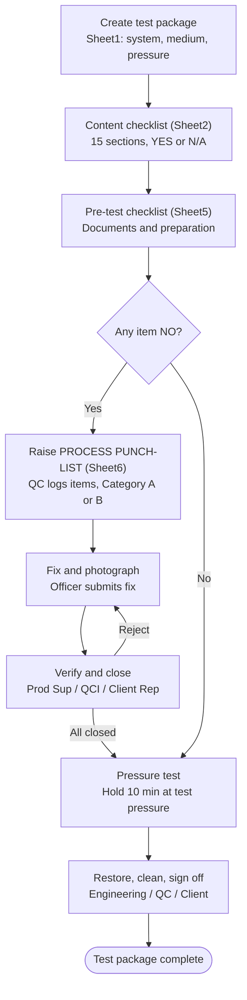

# Test Package — ขั้นตอนการทำงาน (อิงจากไฟล์ CT8-TP-*.xlsx)

หมายเหตุ: Category A = ห้ามทำงานต่อจนกว่าจะปิด · Category B = ทำต่อได้ตามดุลยพินิจของ PM
(จากฟอร์ม: "When above Status indicates NO a punch list must be raised by QC and Pressure Test shall not proceed")
